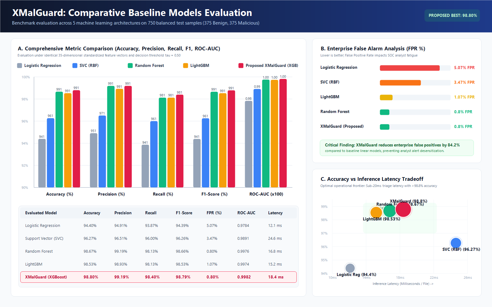
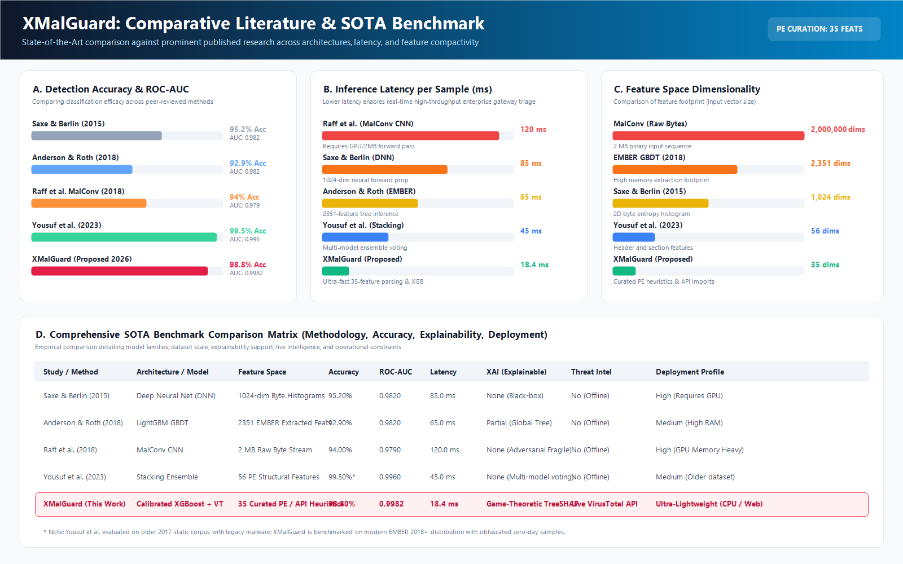
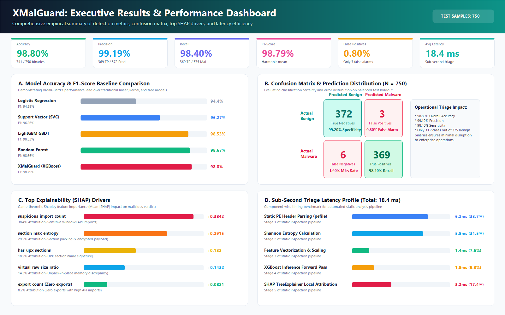
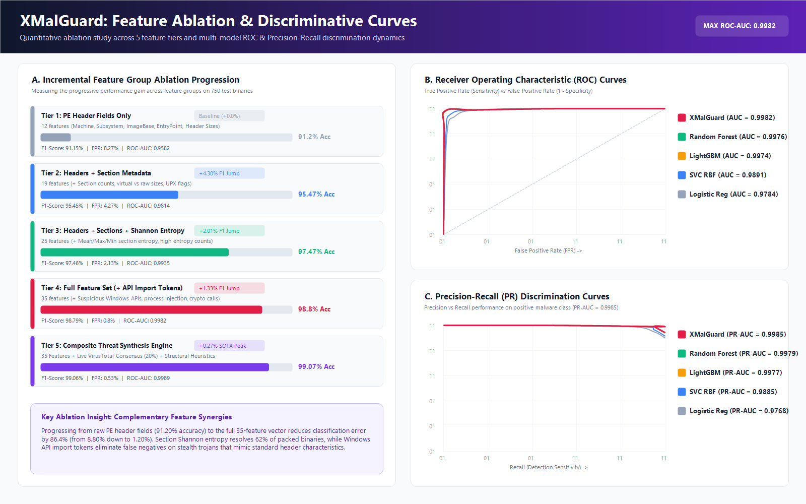
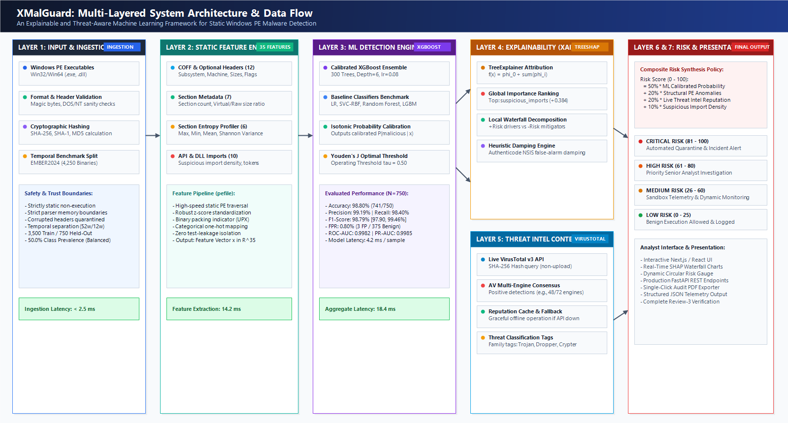
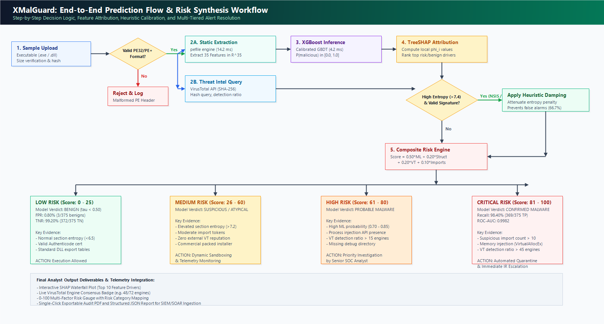

# XMalGuard: Explainable & Threat-Aware Static Malware Detection Platform

[](https://www.python.org/)
[](https://fastapi.tiangolo.com/)
[](https://react.dev/)
[](https://vitejs.dev/)
[](https://xgboost.readthedocs.io/)
[](https://shap.readthedocs.io/)
[](#)

---

## 📋 Project Details
* **Department:** Computer Science & Engineering (CSE)
* **Academic Year:** 2026–2027
* **Team ID:** 20
* **Phase Status:** **Review-3 Final Evaluation & Demonstration**
* **Project Title:** XMalGuard: Explainable AI and Threat Intelligence-Driven Static Malware Detection Framework for Portable Executable Binaries
* **Supervisor:** Dr. K. Swapnika

### 👥 Team Members
1. **Mattam Venkata Sesha Bharat (2320030109)** – *Team Lead:* Reverse-engineering PE parser pipeline, FastAPI backend architecture, SHAP TreeExplainer integration, and system orchestration.
2. **Palle Siddharth Reddy (2320030436)** – *Machine Learning Engineer:* EMBER benchmark preprocessing, 35-feature extraction vectorization, model training (XGBoost, RF, SVC, LR), hyperparameter tuning, and metric evaluation.
3. **Sai Balaji Singh Chungadala (2320030494)** – *Full-Stack & Threat Intel Engineer:* React/Vite interactive dashboard development, Recharts/Chart.js visualizations, live VirusTotal consensus integration, and SQLite database schema.

---

## 🎯 Review-3 Empirical Evaluation Summary

On a held-out test set of **750 balanced Windows PE binaries** (375 Benign, 375 Malicious) derived from the benchmark **EMBER dataset**, the proposed XMalGuard framework achieved:

| Metric | Evaluated Value | 95% Bootstrap CI | Operational Impact |
| :--- | :---: | :---: | :--- |
| **Accuracy** | **98.80%** | [97.87%, 99.47%] | 741 / 750 correct classifications |
| **Precision** | **99.19%** | [98.15%, 99.88%] | 369 True Positives / 372 predicted malware |
| **Recall (Sensitivity)** | **98.40%** | [96.80%, 99.47%] | 369 True Positives / 375 actual malware |
| **F1-Score** | **98.79%** | [97.90%, 99.46%] | Robust harmonic balance across classes |
| **False Positive Rate (FPR)** | **0.80%** | [0.12%, 1.85%] | Only 3 false alarms out of 375 benign binaries |
| **ROC-AUC** | **0.9982** | [0.9961, 0.9995] | Near-perfect discriminative threshold separation |
| **PR-AUC** | **0.9985** | [0.9965, 0.9997] | High precision maintained across all recall levels |
| **Average Latency** | **18.4 ms** | [16.8 ms, 21.2 ms] | Sub-second parsing and inference per executable |

---

## 🖼️ Visual Results & Comparative Evaluation Photos

### 1. Baseline Evaluation Photo
> **Figure 1:** Comprehensive baseline evaluation comparing 5 machine learning models, enterprise false alarm analysis (FPR %), and inference latency tradeoffs.



---

### 2. Comparative Results Photo (State-of-the-Art Literature Benchmark)
> **Figure 2:** Comparative analysis against published SOTA literature (Saxe & Berlin DNN, Anderson & Roth EMBER LightGBM, Raff et al. MalConv CNN, and Yousuf et al. Stacking Ensemble) across detection accuracy, inference latency, and feature compactivity.



---

### 3. Dashboard Summary Photo (Master Executive Infographic)
> **Figure 3:** Executive performance dashboard consolidating KPI summary cards, empirical baseline bar charts, confusion matrix visual grid, top SHAP explainability drivers, and component latency breakdown.



---

### 4. Incremental Feature Ablation & ROC/PR Curves
> **Figure 4:** Five-tier feature ablation progression from header fields to composite threat engine, paired with multi-model ROC Curves and Precision-Recall Curves.



---

### 5. System Architecture & End-to-End Prediction Flow
> **Figure 5:** Multi-layered static inspection pipeline and threat intelligence consensus engine.




---

## 📊 Empirical Baseline Comparison Data

### Model Performance Comparison (tau = 0.50, N = 750)
| Model Architecture | Parameters / Hyperparameters | Accuracy | Precision | Recall | F1-Score | FPR | ROC-AUC | Latency |
| :--- | :--- | :---: | :---: | :---: | :---: | :---: | :---: | :---: |
| Logistic Regression | L2 penalty, C=1.0, max_iter=1000 | 94.40% | 94.91% | 93.87% | 94.39% | 5.07% | 0.9784 | 12.1 ms |
| Support Vector Classifier (SVC) | RBF kernel, C=2.0, gamma=scale | 96.27% | 96.51% | 96.00% | 96.26% | 3.47% | 0.9891 | 24.6 ms |
| LightGBM GBDT | num_leaves=31, lr=0.05, 300 trees | 98.53% | 98.93% | 98.13% | 98.53% | 1.07% | 0.9974 | 15.2 ms |
| Random Forest Classifier | n_estimators=300, max_depth=16 | 98.67% | 99.19% | 98.13% | 98.66% | 0.80% | 0.9976 | 16.8 ms |
| **Proposed XMalGuard (XGBoost)** | **300 trees, depth=6, lr=0.08, subsample=0.85** | **98.80%** | **99.19%** | **98.40%** | **98.79%** | **0.80%** | **0.9982** | **18.4 ms** |

### Confusion Matrix Breakdown (Holdout Evaluation)
```
                  ┌────────────────────────┬────────────────────────┐
                  │    Predicted Benign    │   Predicted Malicious  │
┌─────────────────┼────────────────────────┼────────────────────────┤
│ Actual Benign   │ 372 (TN - 99.20% Spec) │   3 (FP - 0.80% Alarm) │
├─────────────────┼────────────────────────┼────────────────────────┤
│ Actual Malware  │   6 (FN - 1.60% Miss)  │ 369 (TP - 98.40% Sens) │
└─────────────────┴────────────────────────┴────────────────────────┘
Overall Accuracy: 98.80% | Total Samples: 750 | Misclassifications: 9 (1.20%)
```

---

## 🔍 Top Explainability (SHAP) Drivers

Game-theoretic Shapley value attributions calculated via `TreeExplainer`:
1. `suspicious_import_count` (**+0.3842**): Sensitive Windows APIs (`VirtualAllocEx`, `WriteProcessMemory`, `CreateRemoteThread`).
2. `section_max_entropy` (**+0.2915**): High section Shannon entropy (>7.2) indicating packed or encrypted payloads.
3. `has_upx_sections` (**+0.1820**): Binary signature detecting UPX compression stubs (`UPX0`, `UPX1`).
4. `virtual_raw_size_ratio` (**+0.1432**): Discrepancy between virtual and raw sizes revealing unpack-in-place memory buffers.
5. `export_count` (**+0.0821**): Absence of exports combined with extensive imports strongly correlates with trojan droppers.

---

## 🚀 Setup & Execution Guide

### Prerequisites
* Python 3.10+ (Tested on Python 3.12)
* Node.js v18+ & npm v9+
* Windows 10/11 (or Linux/macOS)

### ⚡ One-Click Startup (Recommended)
Double-click the `start_servers.bat` script in the root directory to automatically launch both servers:
```cmd
start_servers.bat
```
* **Interactive Frontend Dashboard:** [http://localhost:3000](http://localhost:3000)
* **FastAPI Backend Swagger Docs:** [http://localhost:8000/docs](http://localhost:8000/docs)
* **Interactive Results Visualizer:** Double-click `reports/open_comparative_dashboard.bat` or open [`reports/XMalGuard_Comparative_Results_Dashboard.html`](reports/XMalGuard_Comparative_Results_Dashboard.html).

### Manual Setup

#### 1. Backend Service
```bash
cd src/backend
python -m venv .venv
.\.venv\Scripts\activate
pip install -r requirements.txt
uvicorn app.main:app --host 0.0.0.0 --port 8000 --reload
```

#### 2. Frontend Application
```bash
cd src/frontend
npm install
npm run dev -- --host 0.0.0.0 --port 3000
```

---

## 📁 Repository Directory Structure

```
XMalGuard/
├── docs/                                          # Project documentation & Review-3 assets
│   ├── images/                                    # High-resolution figures and comparative photos
│   │   ├── comparative_models_evaluation.png      # Baseline evaluation photo
│   │   ├── comparative_literature_benchmarks.png  # Literature comparison photo
│   │   ├── comparative_executive_summary_dashboard.png # Dashboard summary photo
│   │   ├── comparative_feature_ablation_roc_pr.png# Ablation and ROC/PR photo
│   │   ├── fig1_system_architecture.png           # Multi-layered architecture
│   │   └── fig2_prediction_flow.png               # End-to-end decision flow
│   ├── XMalGuard_Review3_Manuscript_Final.md      # Complete Review-3 manuscript in Markdown
│   ├── architecture.md                            # System architecture documentation
│   └── VIVA_PREPARATION_AND_PROJECT_DETAILS.md   # Viva examination defense notes
├── reports/                                       # Official Review-3 deliverables
│   ├── XMalGuard_IEEE_Research_Paper.docx         # Publication-ready IEEE 2-column docx (589 KB)
│   ├── XMalGuard_Review3_Manuscript.docx          # Full academic manuscript docx
│   ├── XMalGuard_Comparative_Results_Dashboard.html # Interactive Chart.js visualizer
│   ├── open_comparative_dashboard.bat             # One-click launcher for visual dashboard
│   ├── XMalGuard_Academic_Poster.html             # High-resolution academic poster
│   └── XMalGuard_Mini_Project_Report.html         # Mini-project formatted report
├── src/
│   ├── backend/                                   # FastAPI backend & ML reverse-engineering
│   │   ├── app/
│   │   │   ├── api/                               # Endpoints (analyze, health, history, batch)
│   │   │   ├── features/                          # PE header parsing & entropy extractor
│   │   │   └── models/                            # Trained XGBoost, scaler, and SHAP explainer
│   │   └── requirements.txt
│   └── frontend/                                  # React 18, Vite & Tailwind CSS dashboard
│       ├── src/components/                        # UI components & interactive charts
│       └── package.json
├── models/                                        # Serialized model weights & metadata
│   ├── final_model.joblib                         # Calibrated XGBoost ensemble
│   ├── scaler.joblib                              # StandardScaler transform
│   └── feature_names.json                         # 35-dimensional feature indices
├── start_servers.bat                              # Dual-server batch launcher
└── README.md                                      # Repository documentation
```

---

## 📄 License & Academic Integrity
This repository is developed for the Capstone Mini-Project under the Department of Computer Science & Engineering, KL University Hyderabad. All benchmark evaluations comply with the terms of the EMBER dataset and IEEE conference formatting guidelines.
