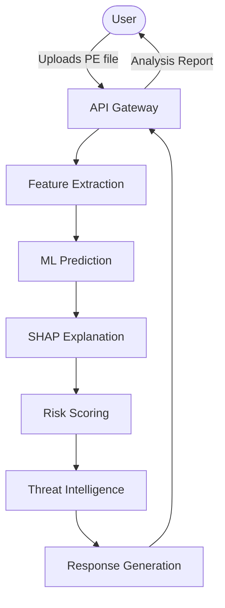
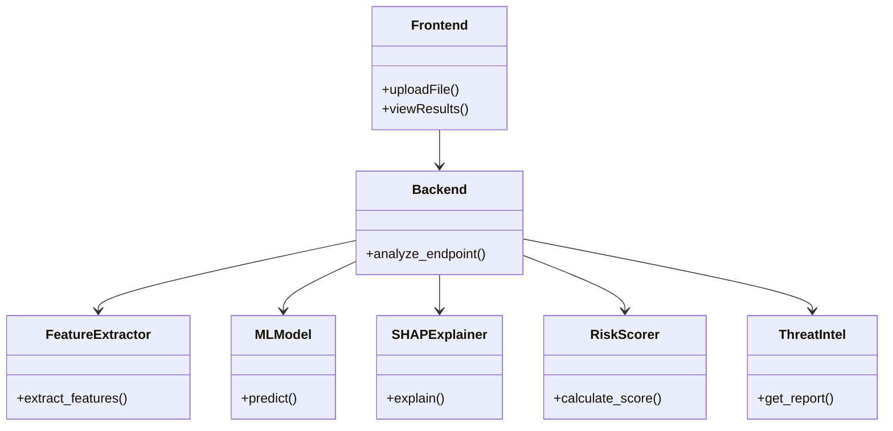

# XMalGuard: System Architecture

## Overview
XMalGuard follows a 4-phase architecture to analyze PE files and provide explainable threat intelligence:
1. Feature Extraction
2. ML Prediction
3. Explainable AI (SHAP)
4. Risk Scoring & Threat Intelligence

## System Components and Data Flow

## Component Descriptions
- **Frontend (React)**: Upload interface, result display, history.
- **Backend (FastAPI)**: API endpoints, file handling, orchestration.
- **Feature Extraction Module**: PE header, sections, imports, strings, entropy.
- **ML Detection Engine**: Model loading, prediction, confidence scoring.
- **XAI Module**: SHAP explainer, explanation formatter.
- **Threat Intelligence Module**: Provider abstraction, VT integration, mock fallback.
- **Risk Scoring Engine**: Weighted composite scoring.
- **Report Generator**: HTML report creation.
- **Database (SQLite)**: Analysis history storage.

## Component Diagram

## Technology Stack
| Component | Technology |
|---|---|
| Frontend | React, Tailwind CSS |
| Backend | FastAPI, Python 3.11+ |
| Machine Learning | scikit-learn, XGBoost/Random Forest |
| Explainable AI | SHAP |
| Feature Extraction | pefile |
| Database | SQLite |

## Security Architecture
- **Static Analysis Only**: PE files are parsed but NEVER executed.
- **Input Validation**: Strict MIME type, signature, and size checks.
- **Secure File Handling**: Files are processed in memory or securely stored temporarily and wiped post-analysis.
- **No Payload Delivery**: The system contains no persistence mechanisms or exploit code.
