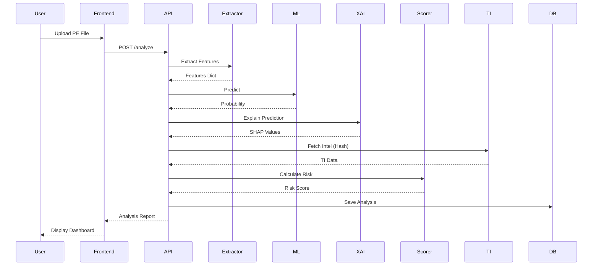

# XMalGuard: Comprehensive Final-Year Project Report

## ABSTRACT
[To be completed: 2-3 paragraphs summarizing the project context, methodology, and key results of XMalGuard.]

## 1. INTRODUCTION
- **Background on malware threats**: The evolving landscape of cyber threats.
- **Need for automated detection**: Scale of new malware variants.
- **Motivation for explainable AI in security**: Trust and actionable insights for analysts.
- **Project scope**: Focus on Windows PE files via static analysis and machine learning.

## 2. PROBLEM STATEMENT
To design and develop a unified, interpretable malware detection system that leverages static feature extraction, machine learning, and explainable AI to provide security analysts with accurate predictions and actionable, transparent risk contexts.

## 3. OBJECTIVES
1. To develop a comprehensive static feature extraction pipeline for Windows PE files.
2. To build an accurate machine learning classification model for malware detection.
3. To integrate Explainable AI (SHAP) to provide feature-level transparency for predictions.
4. To design a unified dashboard incorporating Threat Intelligence and composite risk scoring.

## 4. LITERATURE SURVEY
- **Static malware analysis techniques**: Studies have shown that structural PE features are strong indicators of malicious intent.
- **ML approaches to malware detection**: Studies have shown that ensemble methods like Random Forest and XGBoost excel on tabular static features.
- **Explainable AI in cybersecurity**: Studies have shown that SHAP provides consistent global and local interpretability for security models.
- **Threat intelligence integration**: Studies have shown that combining static analysis with external TI improves detection confidence.
- **Risk scoring methodologies**: Studies have shown that composite weighted scoring aids in threat triage.
*(Note: [To be completed with actual references from literature review])*

## 5. RESEARCH GAP IDENTIFICATION
*See `docs/research_gap.md` for detailed analysis.*

## 6. PROPOSED SYSTEM
- **System overview**: A 4-phase pipeline (Extraction, ML, XAI, Risk/TI).
- **Key features**: Static analysis, SHAP integration, unified risk scoring.
- **How it differs**: Focuses on end-to-end analyst workflow rather than just model accuracy.

## 7. METHODOLOGY
*See `docs/methodology.md` for detailed approach.*

## 8. SYSTEM ARCHITECTURE
*See `docs/architecture.md` for system diagrams.*

## 9. MODULE DESCRIPTION
- **PE Feature Extraction Module**: Parses PE headers, sections, imports, and entropy.
- **ML Detection Module**: Predicts malicious probability.
- **Explainable AI Module**: Generates SHAP values for predictions.
- **Threat Intelligence Module**: Interfaces with external providers like VirusTotal.
- **Risk Scoring Module**: Calculates a composite 0-100 risk score.
- **Dashboard Module**: React-based frontend.
- **Report Generation Module**: Exports findings.
- **Database Module**: Stores historical analysis.

## 10. DATA FLOW

## 11. ALGORITHM
Pseudocode placeholders:
- Main analysis pipeline
- Risk scoring algorithm
- SHAP explanation extraction

## 12. IMPLEMENTATION
- **Technology stack details**: FastAPI, React, pefile, scikit-learn, SHAP.
- **Key implementation decisions**: Modular design, separation of concerns.
- **Code organization**: Strict domain boundaries.
- **Security measures implemented**: No execution, input validation.

## 13. RESULTS
*[To be evaluated with actual experimental results]*

### Model Comparison Table
| Model | Accuracy | Precision | Recall | F1 | ROC-AUC |
|---|---|---|---|---|---|
| Random Forest | [TBE] | [TBE] | [TBE] | [TBE] | [TBE] |
| XGBoost | [TBE] | [TBE] | [TBE] | [TBE] | [TBE] |

### Feature Importance Table
| Feature | Importance |
|---|---|
| [TBE] | [TBE] |

## 14. PERFORMANCE EVALUATION
*[To be evaluated]*
- Detection performance metrics
- Comparison with baselines
- Explainability assessment
- System performance (response time, throughput)

## 15. LIMITATIONS
- Synthetic dataset for development.
- Static analysis only (no dynamic/behavioral).
- Risk scoring not independently validated.
- Single ML model family (no deep learning).
- Threat intelligence dependent on external API.

## 16. FUTURE SCOPE
- Dynamic analysis integration.
- Deep learning models (CNN on raw bytes).
- Adversarial robustness testing.
- Multi-format support (ELF, Mach-O).
- Automated retraining pipeline.
- YARA rule integration.

## 17. CONCLUSION
[Summary of achievements and contributions]

## 18. REFERENCES
*[To be completed with actual references]*
